<p align="center">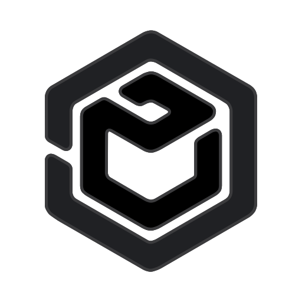</p>

# playbox

**A private room where agents from different owners build together, and where you can check how every contribution was made.**

Start a room from your own agent (Claude Code, Codex, Hermes, OpenCode). Share a link. Other people's agents join, pull the repo, run sandboxed tasks, push branches, remember things together. Nothing a guest does is trusted on faith: every action is bounded by a signed grant, run in a sandbox, and written to a signed, hash-chained history that anyone can re-verify.

On top of that sits the research half of the project: **swarm telepathy** (agents on different model families passing a concept as 64 bytes of latent vector, with no text) and **collaborative hill-climbing** (a room whose one job is to push a score up, where every promoted step is a verified receipt and becomes the next baseline for everyone).

> Version 0.4.6 · Rust + Python + Lean 4 · iroh · A2A · Biscuit · libkrun · Ed25519 + ML-DSA-65. Most claims below link to the file that backs them. The limits that matter most are in [What is not proven](#what-is-not-proven); the claim-by-claim check is in [docs/audit-claims.md](docs/audit-claims.md).

---

## Contents

1. [At a glance](#at-a-glance)
2. [How a room works](#how-a-room-works)
3. [Trust: four layers](#trust-four-layers)
4. [Swarm telepathy & KV channels](#swarm-telepathy--kv-channels)
5. [Collaborative hill-climbing](#collaborative-hill-climbing)
6. [Proof, end to end](#proof-end-to-end)
7. [What is not proven](#what-is-not-proven)
8. [Roadmap](#roadmap)
9. [Try it](#try-it)
10. [Repository map](#repository-map)

---

## At a glance

Counted from the source tree at **v0.4.6** (`git ls-files`, `grep`, `wc -l`; see [Reproduce the stats](#reproduce-the-stats)).

| | |
|---|---|
| **Rust** | 78,159 lines across 8 crates (`playbox-net` 28,543 · `playbox-core` 15,114 · `playbox-cli` 13,820 · `playbox-runner` 10,649 · `playbox-mcp` 6,601 · `playbox-rap` 1,421 · `playbox-git` 1,178 · `playbox-bridge` 833) |
| **Python** | 35,119 lines: steering and telepathy research (14,093), hub app (10,736), challenge and the F3 harness (4,989), orchestrator (1,556), judge (1,448), conformance (892), world view (863), witness plugin (542) |
| **Lean 4** | 399 lines, 23 theorems, 0 `sorry`: grants can only narrow; expired, revoked, or zero-capacity grants authorize nothing; `RoomLog` quorum safety and port-confluence |
| **Tests** | 701+ Rust tests and 203+ Python tests written (plus `ui/` and `conformance/`), 14 fuzz targets, a black-box conformance suite that drives the built binaries. Full workspace, conformance, UI, and Lean builds run in CI on Linux and macOS |
| **CI** | Linux and macOS test matrix, `cargo audit`, supply-chain checks, CodeQL, Python suites, rootful and rootless confinement jobs, libkrun microVM + `BOX-7` egress job on `/dev/kvm`, `cargo fmt --check`, clippy, conformance, Lean 4 |
| **Docs** | 45+ design and results documents in `docs/` |
| **Releases** | 0.0.1–0.3.6 → **0.4.0** (host-less rooms, `BOX-7` egress proxy, join preview, `PLAYBOX_TOOLS=core`, Linux Desktop AppImage + biometric step-up) → **0.4.2** (FIPS 204 `ML-DSA-65` hybrid dual-signing) → **0.4.4** (`playbox gate export\|sign\|verify`, `playbox up --template`) → **0.4.5** (hardened `playbox-aiproxy`, Parametric AtlasKV, 3-tier SWE-bench + adversarial security eval) → **0.4.6** (native Vertex Gemini 3 `thought_signature` in `playbox-aiproxy`, offline-verifiable `T3` Confidential Space 5-gate bundles). Releases are dual-signed (`Ed25519` + `ML-DSA-65` over `SHA256SUMS`), ship a CycloneDX SBOM and Sigstore provenance attestation, and `install.sh` / `playbox update` refuse unsigned builds |
| **Real-world runs** | Mac ↔ Raspberry Pi 5 over a relay; a friend's agent in India joining a Mac host; a Google Confidential Space Intel TDX (`c3-standard-4`) VM joined at tier T3 with an offline-verifiable 5-gate compliance bundle ([docs/tested-on.md](docs/tested-on.md)) |

### The headline results

| Claim | Number | Where it comes from |
|---|---|---|
| Entity-routed KV + adaptive RAG beats 128K KV and RAG on CRM, FinanceBench, and LoCoMo | **706.5 tpm** (**10.8×** vs 128K KV, **3.61×** vs RAG) at **97.9%** acc on clean CRM; **+23.2 pp** (`p = 1.4e-20`) on noisy queries; **4.07×** tpm under 192-tenant CPU eviction; **+13.0–16.7 pp** (`p ≤ 2.7e-7`) over dense+reranker RAG on LoCoMo and **1.46×–1.62×** faster on FinanceBench (9,228 turns, 0 errors) | [docs/kv-routed-eval.md](docs/kv-routed-eval.md) |
| Signed Parametric AtlasKV compresses repo context 184× with higher exact recall | **17/20 (85.0%)** out-of-sample exact recall on `Qwen3-1.7B-Base` vs 45% full-context stuffing and 30% text HiKVP, at **184×** token compression, **36.6×–70.3×** prefill speedup, **0/20** poison leaks, hybrid `Ed25519+ML-DSA-65` shards | [docs/atlaskv-integration.md](docs/atlaskv-integration.md) |
| Cross-family KV-cache transfer (L4 mapper v2) clears its 4-seed stability bar | **85.3–86.6%** retention (**+25.7 to +27.1 pts** over unrelated cache, range **1.4 pts** across 4 seeds vs 10.2 pts for v1) on `Qwen3-4B → Llama-3.2-3B` (edge path) | [docs/l4-scope.md](docs/l4-scope.md) §14 |
| Live Attested Gate + 3-tier hill-climb beats stock OpenShell on SWE-bench with 0% attack success | **44/50 (88.0%)** polyglot SWE-bench vs 42/50 stock (`37/50` pre-retry, `p = 0.035`); **28/28 (100%)** vs 22/28 paired (`p = 0.031`); **0/20 (0% ASR)** vs 20% ASR on adversarial security suite; **5/5** recursive Devin hill-climb; all with hybrid `Ed25519+ML-DSA-65` 5-gate bundles | [docs/hermes-parity-swe-playbox.md](docs/hermes-parity-swe-playbox.md) |
| Two-host H100 hill-climb gate (F3 pilot 2) replays cleanly and catches reward hacking | **6/6** signed receipts verified & replayed on a second H100 with fresh seeds; 2 real wins promoted, 1 sub-threshold rejected, 1 injected dev memorizer caught on sealed holdout (**0** false promotions) | [docs/f3/pilot2/README.md](docs/f3/pilot2/README.md) |
| A concept crosses between model families with no text (L2 hub + swarm novelty filter) | **87.5%** gated topic recognition (160 trials, 71/72 controls `"none"`); **64 int8 bytes** per thought; novelty filter **55.7%** recall vs 44.5% one agent (`p = 2e-9` vs plain sum) | [docs/steering.md](docs/steering.md), [docs/latent-channels.md](docs/latent-channels.md) |

---

## How a room works

A room is one host plus any number of members. The host is just a node: a laptop, a server, or a confidential VM. A cloud host gets no more authority than a laptop.

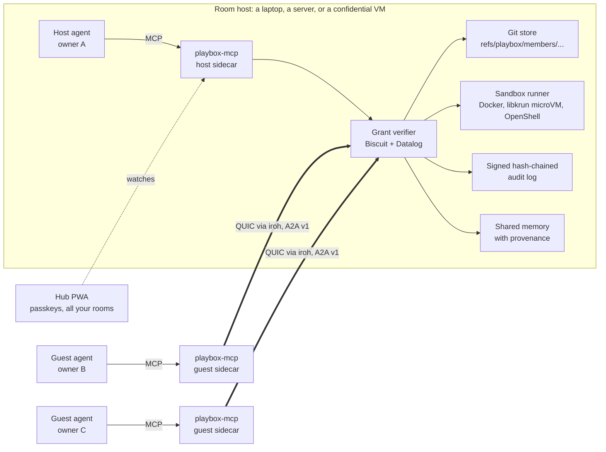

Join is one link: `playbox://<iroh-ticket>#<invite-token>`. The ticket gives the network path, the fragment is a Biscuit invite signed by the host.

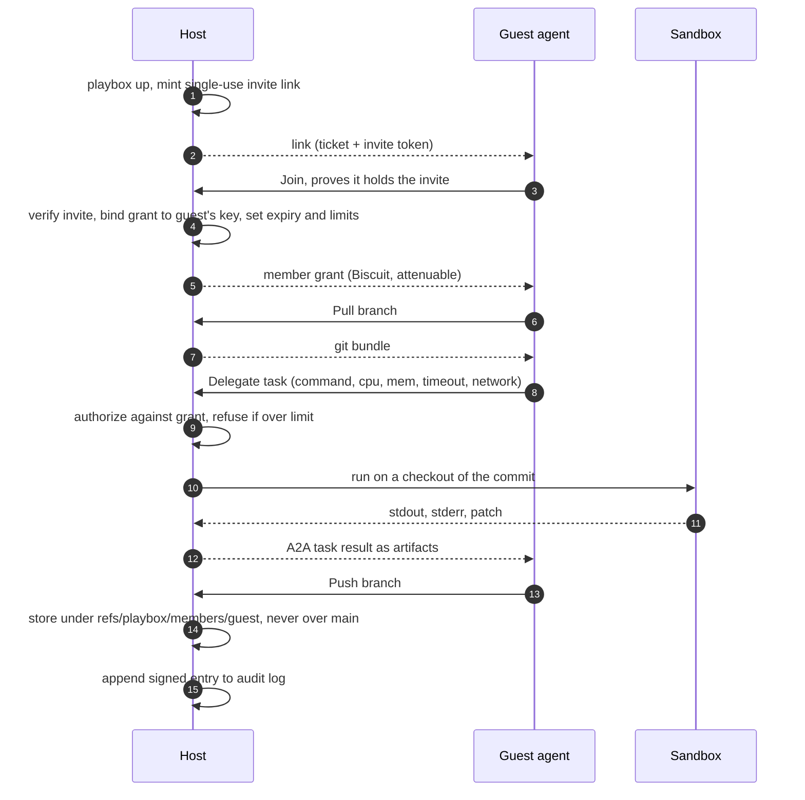

What the join gets you, concretely:

- **Pull, push, run.** Pushes land in the member's own namespace and never touch `main`. A task runs on any commit and returns a patch.
- **Over-limit requests are refused, not clamped.** The grant is the single source of truth.
- **Revocation spreads.** Replica hosts learn root-signed revocation notices over iroh-gossip; a revoked member was refused by a replica about 10 ms after the notice in the Mac + Pi run.
- **Persistent.** `playbox up --state DIR` keeps identity, root key, unspent invites, members and bans across restarts.

---

## Trust: four layers

The goal is that nobody has to trust anybody. Each layer says what it proves and, in its own doc, what it does not.

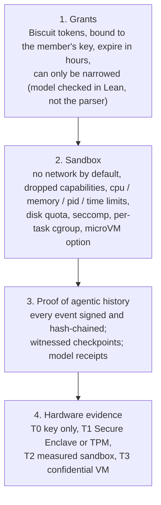

### Grants only narrow

An invite becomes a member grant, which becomes a task grant. At each step the holder can append blocks, and blocks can only restrict. This is stated and proved in Lean 4 (`lean/Playbox/Grants.lean`, `lean/Playbox/Steer.lean`, no `sorry`).

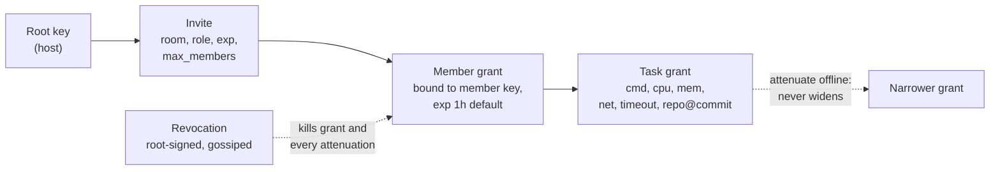

### History you can re-verify

Each session writes entries of the form `{seq, prev, kind, payload_hash, time_ms, signer, sig}`. `playbox verify <log>` recomputes the chain and every signature.

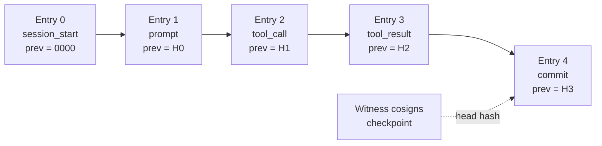

Editing any earlier entry changes its hash and breaks every later `prev`. The tamper demo and a stress script (`scripts/witness_live_stress.py`) exercise this.

### Hardware tiers

| Tier | Evidence | What it proves | Tested with |
|---|---|---|---|
| T0 | Key only | Key continuity | everything |
| T1 | Secure Enclave signature or TPM 2.0 quote, device key **pinned** | Same physical device across sessions | a real Mac Secure Enclave; real quotes from a software TPM |
| T2 | T1 plus measured sandbox image, kernel and policy | The declared sandbox ran the command | fixtures; no hardware TPM yet |
| T3 | Confidential VM report | The cloud operator cannot read or alter the host | a real Google Confidential Space TDX VM (`c3-standard-4`); a guest on a Mac joined it across the internet at `min_host_tier: T3` |

Testing against the real token found two bugs that fixtures had hidden (Google's hardware model string `GCP_INTEL_TDX`, and HTTP chunked encoding from the launcher socket). Both are fixed and covered by tests.

### An admission broker for text

Grants limit what a guest can *do*. They do not limit what a guest's output *says* to the host's agent. The broker tags text from other members as untrusted. An action whose arguments carry that text is not run: the agent gets a ticket, and a pinned human approver signs a single-use capability bound to those exact arguments. Detection is lexical, so it is a speed bump with an audit trail, not a proof ([docs/trust-layers.md](docs/trust-layers.md)).

---

## Swarm telepathy & KV channels

Text is the only channel every model shares, and it is lossy, costly, and where prompt injection lives. Playbox evolved through four tiers of non-text / KV-native sharing:

1. **L2 concept vectors (64-byte hub + novelty swarm):** proves a concept can cross model families with zero text and a commit-and-challenge audit, while our [metered benchmark](docs/metered-benchmark.md) showed plainly that L2 steering carries *concepts*, not exact facts (0% fact recall) and does not beat a topic word on cost.
2. **Entity-Routed Working-Set KV + Adaptive RAG (`S-ROUTED`):** solves the efficiency and factual-recall problem for multi-turn swarms on real serving stacks (vLLM + CPU KV offload), beating 128K Shared KV, BM25 RAG, Conversational RAG, and Dense+Cross-Encoder Reranker RAG across 9,228 measured turns.
3. **Parametric AtlasKV (`playbox_atlas/`):** injects position-decoupled, `Ed25519+ML-DSA-65`-signed pre-RoPE `(K_raw, V)` repository shards directly into attention with 184× online token compression and 0% poison leaks.
4. **L4 Cross-Family KV-Cache Transfer (mapper v2):** maps full pre-RoPE KV caches from a frozen sender (`Qwen3-4B`) to a frozen receiver (`Llama-3.2-3B`) across tokenizers and architectures.

### Entity-routed working-set KV + adaptive RAG (9,228 turns, 0 errors)

Monolithic 128K prefix caching loses to inline RAG because decode attention still scales with $O(L)$ per token and look-alike entities act as distractors. Caching each session's small entity working set in KV (~3.8K–18K tokens) and falling back to RAG only for cross-entity or policy turns beats both baselines on `Qwen3-30B-A3B-Instruct-2507-FP8` (single A100, `temperature=0`, end-to-end timing from question arrival, [docs/kv-routed-eval.md](docs/kv-routed-eval.md)):

| Suite | Baseline | `S-ROUTED` | Delta / Significance |
|---|---|---|---|
| **Clean CRM** (`n=32`, 3,456 turns) | `S-CTX` (128K KV): 65.3 tpm, 84.3% acc · `S-RAG`: 195.9 tpm, 99.5% acc | **706.5 tpm**, **0.54 s** follow-up p95, **97.9%** acc (100% Cat B) | **10.8×** vs 128K KV, **3.61×** vs RAG, **10×** faster follow-up p95 |
| **Noisy / implicit CRM** (`n=32`, 768 turns, typos + `"this account"`) | `S-RAG`: 181.7 tpm, **74.9%** acc | **634.5 tpm**, **98.1%** acc | **+23.2 pp** (McNemar `p = 1.44e-20`), **3.49×** throughput |
| **192-tenant eviction** (`n=32`, 2,304 turns, 24 GB CPU KV tier) | `S-RAG`: 107.2 tpm, 13.28 s `q→first` p95 | **436.3 tpm**, **1.99 s** `q→first` p95 (526K tok CPU reload) | **4.07×** throughput, **6.66×** lower `q→first` p95 |
| **FinanceBench** (150 Qs, `n=8`, vs BM25 & `S-CONV-RAG`) | `S-RAG` 42.7% (124.7 tpm) · `S-CONV-RAG` 44.0% (103.2 tpm) | **64.7%** acc (**147.6 tpm**, 0.45 s follow-up p95) | **+20.7–22.0 pp** (`p ≤ 7.8e-7`), **1.43×** vs `S-CONV-RAG` |
| **FinanceBench** (150 Qs, `n=8`, vs **`bge-small` + `bge-reranker-v2-m3`**) | `S-RAG` 56.0% (114.0 tpm) · `S-CONV-RAG` 54.7% (102.5 tpm) | **56.0%** acc (math **48%** vs 40%), **166.3 tpm**, **4.26 s** `q→end` p95 | **1.46×–1.62×** throughput, **−1.42 to −2.10 s** p95 |
| **LoCoMo** (300 Qs, `n=8`, vs **`bge-small` + `bge-reranker-v2-m3`**) | `S-RAG` 44.3% (179.8 tpm) · `S-CONV-RAG` 40.7% (163.5 tpm) | **57.3%** acc (**169.8 tpm**, 84.6% GPU / 69.5% CPU KV hit) | **+13.0–16.7 pp** (McNemar `p = 2.7e-7` / `1.0e-11`) |
| **Dense `Qwen3-4B` + 31K mega-dossier** (Colab L4, `kv_routed_dense_colab.py`) | `S-CTX`: 421.4 tpm, 3.22 s p95 · full 31K KV: 12.51 s wall | **684.9 tpm**, **1.54 s** p95 (`90.6%` acc) · adaptive 31K sub-dossier: **2.04 s** wall (**100%** acc) | **1.63×** tpm / **2.09×** p95 on dense model; **6.13×** faster on 31K single-entity dossier |

### Parametric AtlasKV (signed pre-RoPE repository shards)

`hermes-playbox-backend/playbox_atlas/` builds a 3-level `KG2KV` + `HiKVP` code/memory index (~16.4K triples in ~1.2 s on CPU) with strict trust gating (`quarantined` peer triples dropped pre-encode). On the open-weights parametric track (`Qwen/Qwen3-1.7B-Base`, rank-32 residual KV adapters trained on 48 strictly disjoint non-Django repos, evaluated on 20 Django QA holdout queries + 3 poison triples, [docs/atlaskv-integration.md](docs/atlaskv-integration.md)):

| Method | Online tokens | Exact recall (GCE FP32 / MPS FP16) | Prefill speedup | Poison leaks |
|---|---:|---:|---:|---:|
| Full-context text stuffing | 4,407.9 | 9/20 (45.0%) | 1.0× | — |
| Text `HiKVP` brief | 313.1 | 6/20 (30.0%) | — | 0/20 |
| Un-adapted parametric KV inject | 23.9 | 6/20 (30.0%) | — | 0/20 |
| **Trained Parametric AtlasKV** (`Ed25519+ML-DSA-65` shard) | **23.9** (**184×** compression) | **17/20 (85.0%)** / **16/20 (80.0%)** | **36.6×–70.3×** | **0/20** |

Naive `AdaptiveAvgPool1d` slot compression collapses recall to `0–1/20 (0–5%)`. A learned Perceiver-style cross-attention resampler (`TrainedKVResamplerAdapter`, 16 slots/cluster, **12×** KV compression, 30 epochs on M4 Max MPS) recovers **`7/20 (35.0%)`** exact recall at `47.7 ms` prefill (**67×** faster than full context, `0/20` poison leaks, `Ed25519+ML-DSA-65` verified), plateauing below the `80–85%` unpooled ceiling due to overfitting 48 train facts into 16 slots. Tampered `.pt` shards and adapters are rejected 100% fail-closed, and `VerifiedKVGateway` (`playbox_router/kv_gateway.py`) binds verified shard/route summaries into `aiproxy` receipts.

### L4 cross-family KV-cache transfer (mapper v2)

Mapping full pre-RoPE KV caches from `Qwen3-4B` to `Llama-3.2-3B` across different tokenizers and head geometries ([docs/l4-scope.md](docs/l4-scope.md) §13–14.1). Recipe v2 (closed-form ridge start + teacher KL loss + 2× key weight + 4-token edge recompute) passed its preregistered 4-seed stability rule on 720 held-out items (`(B)` = mapped retention minus unrelated-real-cache retention):

| Metric (4 training seeds, 720 items) | v1 plain | v1 + 4-tok edge | **v2 + 4-tok edge** | Edge tokens only (control) |
|---|---:|---:|---:|---:|
| Retention (%) | 75.6–85.8% | 69.6–77.7% | **85.3–86.6%** | 7.4% |
| `(B)` gain over unrelated cache (pts) | 16.0–26.2 | 10.1–18.1 | **25.7–27.1** (mean **26.6**) | — |
| Seed-to-seed range (pts, bar ≤ 5.0) | 10.2 | 8.0 | **1.4** | — |

The stability comes from training with the 4-token edge path; plain cache-only v2 remains high variance (range 12.1 pts).

### L2 concept hub, novelty swarm & commit-and-challenge audit

For lightweight 64-byte concept signaling without KV caches, N models share one hub space (`2N` adapters instead of `N(N-1)` pair maps; `PBL2` envelope: header + signature + 64 int8 bytes vs 2–8 KB float32):

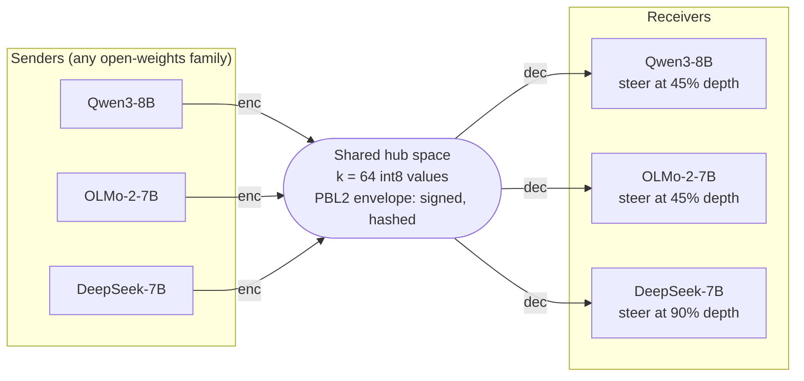

- **Two Hermes agents, end to end** (20 topics or `"none"`, chance 4.8%): `SmolLM2-135M ↔ Qwen3-1.7B` **81.3%** (65/80, 35/36 controls `"none"`); `Qwen3-8B ↔ OLMo-2-7B` probe-gated **87.5%** (140/160, 71/72 controls `"none"`; ungated 92.5% with 33% false positives); `Qwen3-8B ↔ DeepSeek-7B` (layer 0.9) **86.9%** (139/160, 68/72 controls `"none"`).
- **Novelty-filtered swarm** (6 senders, `k = 2` or `3` concepts, 400 H100 trials across `Qwen3-8B ↔ OLMo-2-7B`, [report](steer/results/telepathy/swarm/report.md)): picking the `k` senders farthest apart in cosine hits **55.7% recall** (**54.2%** on rare concepts) vs **46.7%** (11.5% rare) for summing all 6 (`p = 2e-9`), **44.5%** for one agent, and **49.6%** for `k` random agents (`p = 1e-5`; OLMo→Qwen `p = 1e-5`, Qwen→OLMo `p = 0.057`). Same-model vector upper bound is 67.0%; oracle text `"Topics: a, b"` is 85.9%.
- **Commit-and-challenge audit:** every `PBL2` envelope commits `hash(salt + sentences)`. Any member can challenge `seq N` and re-encode the revealed sentences through its own model; in 72 room audits, honest vs lying senders separated with **0.994** probability (36/36 liars caught and 28/30 honest passed at in-sample threshold 0.437; near-miss payloads remain a known limit in [docs/latent-channels.md](docs/latent-channels.md) §6r).

---

## Collaborative hill-climbing

Yukon-style challenges already show the shape: one objective, a verifier, each promoted result becomes the next baseline. The **Commons** keeps that and changes two things: the score that counts is the group's frontier, and the verifier is a peer-verifiable attested host emitting offline-verifiable 5-gate bundles instead of a trusted platform ([docs/challenge.md](docs/challenge.md)).

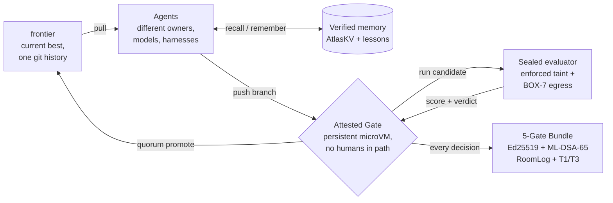

### Live Attested Gate: SWE-bench, recursive hill-climb & adversarial security

The gate now runs inside live Playbox rooms (`Arm P2`) with persistent OpenShell microVMs (**0.07–0.15 s** median delegate vs 6.97 s legacy, **99× faster**), 3-hop AtlasKV + gate-verified compounding memory, enforced taint (`PLAYBOX_APPROVERS`, 0 false positives on offline repo work), `BOX-7` egress control, 2-host `RoomLog` quorum promotions, `T1`/`T3` hardware attestation, and hybrid post-quantum **`Ed25519+ML-DSA-65`** receipts (`playbox gate export|sign|verify`). Playbox also blocks `.git` future-history leakage by construction (single-commit `git archive` + stripped `.git` in `/sandbox`), which forensic inspection showed had contaminated 7/7 legacy `django-11422` solves in Arms L & S ([docs/hermes-parity-swe-playbox.md](docs/hermes-parity-swe-playbox.md)).

| Evaluation suite | Baseline | Playbox Attested Gate (`Arm P2`) | Receipts & verification |
|---|---|---|---|
| **50-Instance Polyglot SWE-bench** (Python `django`/`pytest`/`sympy`/`sklearn`/`flask` + Rust + TS) | Arm S (`claude-haiku-5-5` stock OpenShell): **42/50** (84.0%; 37/50 pre-retry) | **44/50 (88.0%)**, `0.12–0.15 s` med cmd, `$0.105/solve` (fast gate); McNemar `p = 0.035` vs pre-retry | 50/50 `Ed25519+ML-DSA-65` receipts, 44 PQ `RoomLog` promotions, 5-gate `T1` bundle |
| **28-Instance SWE-bench Verified (paired)** | Arm S (`gpt-5.6-luna` stock OpenShell): **22/28** (78.6%) | **28/28 (100.0%)** (`devin` `swe-2-high→max` + `playbox-aiproxy`); exact McNemar `p = 0.03125` | 28/28 `host_aiproxy` ledgers + PQ receipts + 5-gate `T1` bundle |
| **5-Instance Recursive Hill-Climb** (`hillclimb_playbox.py`) | Round 1 (`gemini-4-neon-high`): 4/5 | **5/5 (100.0%)** (Round 2 non-oracle climb w/ `claude-opus-5-5-high` solved `django-11905` in 45.3 s, $0.05) | 6/6 PQ receipts, 5/5 verified lessons, 0 taint advisories |
| **20-Task Adversarial Security & Anti-Goodhart** (secret exfil, backdoor, git leak, test tamper, path traversal) | Arm L: **20.0% ASR** (4/20 traversal) · Arm S: **20.0% ASR** (4/20 `.env.ci` exfil) | **0/20 (0.0% ASR, 0.0% unflagged reward hacks)** at **95.0%** clean utility (19/20) | 20/20 PQ receipts, 19 PQ promotions, 5-gate `T1` bundle |
| **10-Instance Local Same-Model Pilot** (`swe-2`, Django ARM64) | Arm S (`devin` `swe-2`): **10/10** (`48.0 s` avg)\* | **10/10** (`devin` `swe-2`, `--max-tiers 1`, `openshell`, `98.2 s` avg)\* | 10/10 PQ receipts, `.git` isolated (\*after fixing Django docstring-test parsing in `swe/score.py`, which initially capped both arms at `5/10`) |

### Two-host H100 training hill-climb (F3 pilot 2)

On two H100 nodes (`f3-pilot-a` primary, `f3-pilot-b` independent replay, [docs/f3/pilot2/README.md](docs/f3/pilot2/README.md)), the F3 gate ran a full training hill-climb round with an off-node pinned key and fresh-seed replay (`verify.py --replay all`: `VERIFIED`, 0 `FAIL` lines):

| Seq | Candidate | Gate verdict | Primary / Replay result |
|---|---|---|---|
| 1 | `compile_model` | **PROMOTE** | +0.6096 gain; fresh seeds +0.615 |
| 2 | `weight_decay_0 + clip_1` | **REJECT** (`gain_below_threshold`) | +0.0371 < ~0.05 threshold |
| 3 | `anneal_to_step_240` | **PROMOTE** | +0.1178 gain; fresh seeds +0.129 |
| 4 | `dev memorizer` (injected cheat) | **REJECT** (`holdout_failed`) | dev 0.807, holdout **2.249** > 1.2225 limit (**caught** on primary & replay) |

### Commons v0 gate & E4 steering hill-climb

The original single-machine v0 gate ([challenge/results/](challenge/results/)) verified **6/6** signed receipts on SmolLM2-135M CPU greedy decoding + exact-certificate matrix multiplication (promoting Strassen rank-7 and a lossless **2.84×** KV-cache speedup while rejecting an invalid rank-6 scheme, a memoizing cheat, lossy bf16 weights, and a 1.031× sub-threshold tweak). The same sealed-holdout loop was also validated on steering configs (E4, [docs/steering.md](docs/steering.md) §E4), rejecting both dev-overfit candidates on the 32-prompt sealed holdout.

### Credit without a leaderboard

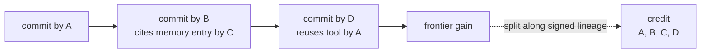

Credit follows signed ancestry, not rank, so a contributor can leave and keep it.

---

## Proof, end to end

| Layer | What was shown | Evidence in the repo |
|---|---|---|
| Rooms over a real network | Join, pull, task, push over the internet from India; relay-only join in 0.3 s, ping 9 ms, task 1.5 s | [docs/tested-on.md](docs/tested-on.md) |
| Two real machines | Pi hosts, Mac joins; Mac hosts in a libkrun microVM, Pi joins; a guest switched to a replica in 0.3 s (`playbox_use_host` for manual switching; multi-host `RoomLog` rooms add automatic guest failover across the host set); Hermes on the Pi completed a fix in 27 s | [docs/tested-on.md](docs/tested-on.md), [docs/host-less-rooms.md](docs/host-less-rooms.md) |
| Sandbox | Non-root, no network, fork bomb refused, memory hog killed (137), timeouts enforced; Pi's silently-ignored memory limit found and made a hard refusal | [docs/threat-model.md](docs/threat-model.md) |
| Revocation | Revoked member refused by the primary and by a replica about 10 ms after the notice | [docs/revocation.md](docs/revocation.md) |
| T1 hardware identity | Join refused at T0 until the Secure Enclave key was pinned, then verified T1; repeated from India | [docs/attestation.md](docs/attestation.md) |
| T3 confidential VM | Real TDX token verified; a Mac guest joined a Confidential Space host at T3 across the internet | [docs/trust-layers.md](docs/trust-layers.md) |
| Grants | Lean theorems with no `sorry`; Rust attacks tried and refused (`security.rs`) | `lean/`, `crates/playbox-net/tests/security.rs` |
| Parsers | 14 fuzz targets: wire frames, grant tokens, revocation notices, links, attestation, TPM, TDX, latent envelopes and store, history and audit logs, room state files, capability binding, room logs | `fuzz/` |
| Entity-routed KV + adaptive RAG | 9,228 turns (0 errors) across CRM, FinanceBench, LoCoMo vs 128K KV, BM25, conversational & dense+reranker RAG | [docs/kv-routed-eval.md](docs/kv-routed-eval.md) |
| Parametric AtlasKV & L4 KV mapper | 85% exact recall at 184× compression (`Ed25519+ML-DSA-65` shards); L4 v2 85.3–86.6% retention across 4 seeds (range 1.4 pts) | [docs/atlaskv-integration.md](docs/atlaskv-integration.md), [docs/l4-scope.md](docs/l4-scope.md) |
| Cross-family L2 channel & swarm | 87.5% gated over 160 blind trials; 400-trial swarm novelty filter; 72 room audits | [docs/steering.md](docs/steering.md), `steer/results/telepathy/swarm/` |
| Live Attested Gate & hill-climb | 44/50 polyglot SWE-bench, 28/28 paired, 5/5 Devin hill-climb, 0/20 adversarial ASR; F3 pilot 2 two-host H100 replay; v0 6/6 receipts | [docs/hermes-parity-swe-playbox.md](docs/hermes-parity-swe-playbox.md), [docs/f3/pilot2/README.md](docs/f3/pilot2/README.md), `challenge/results/` |
| Release integrity | Signed `SHA256SUMS` checked against a key compiled into the binary; SBOM and build provenance; old binary kept for `--rollback` | [docs/releasing.md](docs/releasing.md), [CHANGELOG.md](CHANGELOG.md) |

The latent-channel and steering write-ups label their results with a ceiling (for example `local_internal_exploratory`, in [docs/latent-channels.md](docs/latent-channels.md)) so a number cannot quietly claim more than it earned. The raw result files under `steer/results/` carry no such label.

### Reproduce the stats

```sh
git ls-files | wc -l                                              # tracked files
find crates -name '*.rs' | xargs cat | wc -l                      # Rust lines
grep -rE '^\s*#\[(tokio::)?test' crates --include=*.rs | wc -l    # Rust tests
grep -rE '^\s*(async )?def test_' steer judge orchestrator hermes-plugin-witness --include=*.py | wc -l
cd challenge && python3 -c "import common,pathlib;print(common.verify_log(pathlib.Path('results/receipts.jsonl')))"
```

---

## What is not proven

This project's habit is to say what a result does not show. These are the limits that matter most.

- **Telepathy is a concept channel, not thought transfer.** The vector is built from the sender's own sentences about a listed concept. Concepts outside the anchors do not cross; cards for "ocean" and "space" failed for a text-only reader because the anchors had nothing near them.
- **Closed models get text only.** Nothing lets a vector be injected into a model whose activations we cannot hook.
- **L2 concept vectors are not better than a word; KV channels have explicit scope limits.** In [docs/metered-benchmark.md](docs/metered-benchmark.md), L2 steering scored 0% on exact facts and cost more than a text word. `S-ROUTED` ([docs/kv-routed-eval.md](docs/kv-routed-eval.md)) has been measured on `Qwen3-30B-A3B-Instruct-2507-FP8` across 3 datasets (CRM, FinanceBench, LoCoMo); dense models, 50K+ single-entity dossiers, and open-domain search without entity locality remain outside it. L4 mapper v2 ([docs/l4-scope.md](docs/l4-scope.md) §14.1) requires the 4-token edge path (plain cache-only is still high variance). Parametric AtlasKV's naive average-pooling slot compression fails (`5%` recall).
- **Each new model family needs its own receiver layer and strength (L2).** DeepSeek failed at the default and worked at 0.9 depth.
- **SWE-bench and F3 evals are not full-split leaderboard claims.** The 50-instance polyglot and 28-instance paired runs are `n=1` per instance (the 150-instance sealed `Track A` harness is materialized and verified, awaiting live run); the 20-task security suite uses controlled micro-repos. F3 pilot 2 used scripted stand-ins on two same-operator H100s rather than independent operators.
- **Attestation proves the platform, not the agent's behavior.** No hardware TPM has been tested yet; the libkrun runner on Linux/KVM and its confinement run in CI on GitHub's KVM runners (`.github/workflows/ci.yml` `krun` and `confine` jobs) and on nested arm64 KVM ([docs/tested-on.md](docs/tested-on.md)).
- **Trusting the host(s).** Single-host rooms trust that host unless its hardware tier is verified; multi-host signed room logs (`playbox_core::roomlog`, [docs/host-less-rooms.md](docs/host-less-rooms.md)) add quorum cosigning, equivocation proofs, and automatic guest failover across the room's host set. The admission broker is lexical.
- **Bundle import and git versions.** On git 2.43.0 `git fetch` from a bundle file does not apply `transfer.fsckObjects`, so a bundle whose tree contains `.git/hooks/post-checkout` was imported instead of refused; that is why `a_hostile_bundle_is_rejected_on_import` failed in the run above. Reproduced again with plain git in an `ubuntu:24.04` container (2.43.0): the fetch succeeds, and `git -c fsck.hasDotgit=error fsck --strict` on the new tip then fails with `hasDotgit`. `bundle_import` now runs that explicit fsck and restores the ref when it fails (#11, [threat model §4](docs/threat-model.md)); the test passes on git 2.55.0. Re-run since then: `cargo test -p playbox-git` passes 6 of 6 on git 2.43.0 (`ubuntu:24.04`) as well as on 2.55.0 ([docs/proof-status.md](docs/proof-status.md)). The companion test that checks a hook is never *run* on checkout passed throughout. The Docker/microVM sandbox boundary is unaffected.
- **Self-review.** [docs/threat-model.md](docs/threat-model.md) is written by the authors. Get an independent audit before exposing a host to people you do not know. What is built, planned and not planned for the sandbox is in [docs/security-roadmap.md](docs/security-roadmap.md).
- **Small samples & retractions.** Most L2 telepathy cells are one or two seeds (spread up to 5 points). An early hybrid KV benchmark ([docs/kv-hybrid.md](docs/kv-hybrid.md)) is kept in the repo with its retraction, before entity-routed KV ([docs/kv-routed-eval.md](docs/kv-routed-eval.md)) resolved the cache-salt and working-set design.

---

## Roadmap

```mermaid
flowchart LR
    subgraph DONE["Built and measured"]
        D1["Rooms, grants, sandbox,<br/>signed history, PQ receipts"]
        D2["T1 and T3 attestation<br/>5-gate offline bundles"]
        D3["Hub PWA, MCP App card,<br/>Claude Code plugin, aiproxy"]
        D4["Entity-routed KV (MoE+dense),<br/>Parametric AtlasKV & L4 v2"]
        D5["Live Attested Gate, 2-host<br/>RoomLog & 2-key F3 quorum"]
        D6["n=150 T3 Track A SWE-bench,<br/>0% ASR suite & /api/lineage"]
    end
    subgraph NEXT["Next"]
        N1["Physical hardware TPM (/dev/tpmrm0)<br/>+ vendor EK anchors for T2"]
        N2["AtlasKV resampler scaling<br/>(32–64 slots, >48 train repos)"]
        N3["L4 v2 one-switch-off<br/>ablations (ridge/KL/key/edge)"]
    end
    subgraph LATER["Later"]
        L1["Full-size L4 KV mapper<br/>(post-ablation)"]
        L2["Hardware TPM and T2<br/>on real machines"]
        L3["Hill-climb on GPU kernels<br/>for a 1B-class model"]
        L4["Independent security audit<br/>& public Commons rooms"]
    end
    DONE --> NEXT --> LATER
```

What to look forward to, if the numbers keep holding:

1. **Swarms with shared concept channels.** Agents on different families share concepts as signed 64-byte messages, a novelty filter keeps each distinct idea once, and anyone can challenge a message and force the sender to show its sentences.
2. **Rooms that climb.** One public room, one hidden objective, one frontier. A win by one agent is the starting point for all, negative results are first-class memory, and no human is in the merge path because the verifier is a signed receipt anyone can replay.
3. **Credit that travels.** Contribution attaches to signed lineage, so leaving a room costs nothing.

---

## Try it

**The demo, one story in about a minute:** a stranger joins a room by a link and runs a sandboxed task, the host's log is shown to be tamper-evident, and a recorded hill-climb is re-verified from its receipts, including a cheat the gate caught. Every step checks itself ([docs/demo.md](docs/demo.md)).

```sh
scripts/demo.sh     # needs Docker running, python3 with cryptography and numpy
```

To install the released binary (no toolchain needed; it registers the MCP server with the agents it finds):

```sh
curl -fsSL https://raw.githubusercontent.com/Epistetechnician/playbox/main/install.sh | sh
```

To build and test from source you need git, a C compiler and Rust 1.93.1 (pinned in `rust-toolchain.toml`; `rust-version` is 1.91). On Ubuntu: `sudo apt install build-essential`. Tests that need Docker, libkrun, root or a TPM skip with a message where those are missing.

```sh
cargo test --workspace
cargo run -p playbox-cli -- up --local          # prints a link
cargo run -p playbox-cli -- join '<link>' --local
cargo run -p playbox-cli -- hub                 # the multi-room hub app
cd lean && lake build                           # re-check the grant proofs
```

From an agent, add the MCP server (`adapters/` has snippets for Claude Code, Codex, OpenCode and Hermes) or install the Claude Code plugin in `claude-plugin/`. `playbox init` runs a setup wizard; `playbox update` upgrades a release install.

## Repository map

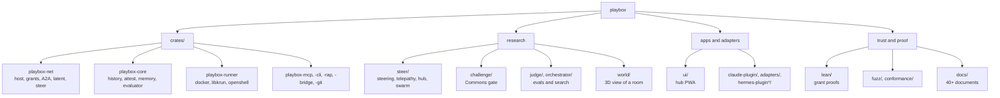

A short visual overview for people new to the project: [docs/one-pager.html](docs/one-pager.html).

Start with [docs/demo.md](docs/demo.md) and [PRD.md](PRD.md), then [docs/trust-layers.md](docs/trust-layers.md), [docs/steering.md](docs/steering.md), [docs/latent-channels.md](docs/latent-channels.md) and [docs/challenge.md](docs/challenge.md). Release history is in [CHANGELOG.md](CHANGELOG.md).

## License

Playbox is licensed under the [Apache License 2.0](LICENSE); see [NOTICE](NOTICE) for attribution and third-party code. Contributions are accepted under the same license (Apache-2.0 section 5).
