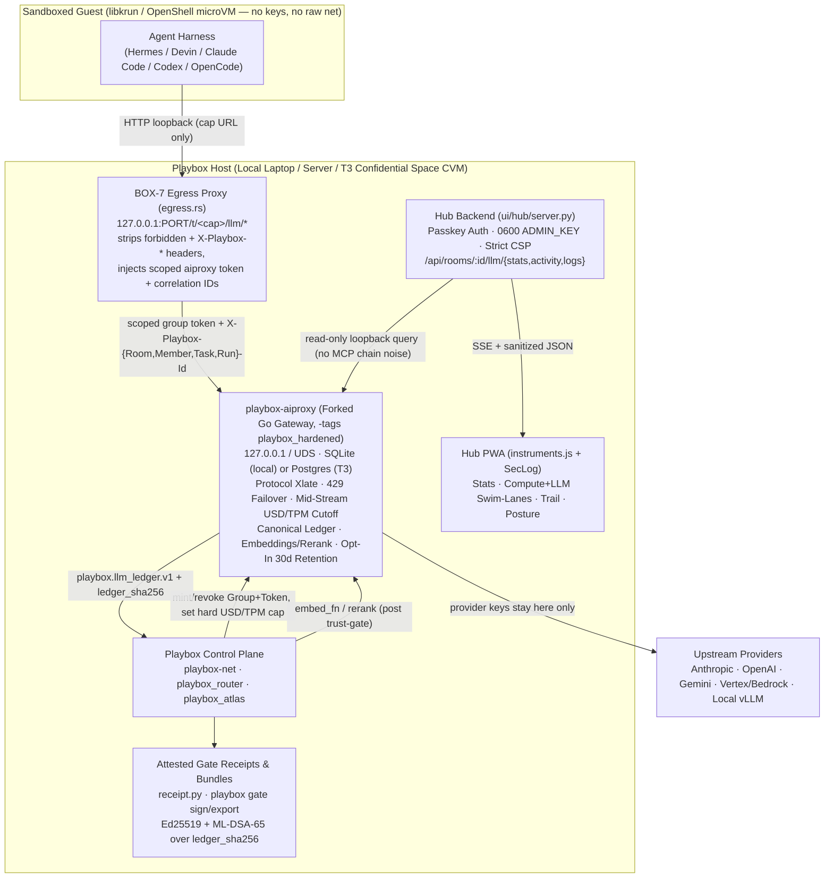

# Playbox AI Proxy (`playbox-aiproxy`): Fork, Hardening & End-to-End Integration PRD

Status: **Draft v0.1** · 2026-11-19 · owner: Playbox · scope: `playbox-aiproxy` (fork of `labring/aiproxy`), `playbox-runner` (`BOX-7`), `playbox-net`, `playbox-cli`, `hermes-playbox-backend` (`playbox_router`, `playbox_atlas`), `ui/` (Hub), `tools/bench/`, `challenge/`
Anchors: [v0.4-strategy.md](v0.4-strategy.md) (**Playbox Attested Gate**), [box7-egress-proxy-plan.md](box7-egress-proxy-plan.md), [security-roadmap.md](security-roadmap.md), [agent-identity-prd.md](agent-identity-prd.md), [hermes-parity-swe-playbox.md](hermes-parity-swe-playbox.md).

---

## 1. One line

Fork and harden `labring/aiproxy` into **`playbox-aiproxy`** — a host-side, zero-plugin, ledger-emitting model gateway sitting directly behind Playbox's `BOX-7` egress proxy — so every agent harness, room, benchmark, Hub panel, and post-quantum receipt shares one failover-resilient, hard-budgeted, host-attested model plane.

---

## 2. Problem

Playbox has hardened execution (`libkrun` / `OpenShell` + `BOX-2..7`), grants (`Biscuit` + Lean 4), taint (`BOX-15` + `witness.py`), and post-quantum receipts (`Ed25519 + ML-DSA-65`). The **model API boundary** remains fragmented and weakly enforced across five concrete failure modes:

1. **429 cooldown stalls & split auth pools:** During live SWE-bench runs (`django-11422-P2-3`), a single Anthropic OAuth `429` stalled execution for ~20 minutes. Today Hermes (`~/.hermes/auth.json`), Devin (`credentials.toml`), Claude Code, Codex, and OpenCode each maintain separate credential stores, retry loops, and wire protocols (Anthropic Messages, OpenAI Chat/Responses, Gemini native). Switching or failing over across `gemini-4-neon-high`, `claude-opus-5-5-high`, and `gpt-5.6-luna` requires harness-specific glue.
2. **Post-hoc budget enforcement:** `BudgetCap` in `hermes-playbox-backend/playbox_router/router.py` charges `c.cost_usd` *after* a worker returns. A runaway worker loop can overshoot `max_worker_usd` and `max_total_usd` mid-run before the router ever sees it.
3. **Client-reported (untrusted) token & cost accounting:** Receipts (`playbox.attested_gate_receipt.v1`) and benchmark reports currently rely on client/harness-reported `usage.json` or `sessions.db` estimates rather than a host-observed ledger measured at the network boundary.
4. **Model-layer blindness in the Hub & retention gap:** The Hub (`ui/hub/rooms.py`, `ui/static/instruments.js`) displays messages, delegated sandbox timings, witness holds, and chain checks, but has zero visibility into LLM latency, TTFT, retries, failovers, cache-hit ratio, reasoning tokens, or live USD burn. Meanwhile, [PRD.md](../PRD.md) Risk #2 (model-boundary history fidelity) and [security-roadmap.md](security-roadmap.md) (opt-in 30-day transcript retention separate from the hash-only `audit.log`) remain open.
5. **Lexical-only `playbox_atlas` retrieval:** `HiKVPIndex` in `hermes-playbox-backend/playbox_atlas/hikvp.py` already exposes an `embed_fn` hook, but defaults to TF-IDF so it needs no local GPU or per-provider embedding SDK.

---

## 3. Goals & non-goals

### Goals
1. **Zero 429 stalls & unified routing across all harnesses:** One local endpoint behind `BOX-7` translating Anthropic Messages ↔ OpenAI Chat/Responses ↔ Gemini native, with millisecond per-key / per-channel 429 failover and configurable model-alias fallback chains.
2. **Hard mid-turn USD & TPM enforcement at the network boundary:** Every Playbox room maps to an `aiproxy` Group and every worker/member grant maps to a short-lived scoped Token with hard USD/TPM/RPM ceilings (including prompt-cache billing) that cut off runaway streams mid-turn.
3. **Host-attested token & cost ledger bound into `playbox.attested_gate_receipt.v1`:** Pull deterministic host-side usage records (`input_tokens`, `cached_tokens`, `output_tokens`, `reasoning_tokens`, `ttft_ms`, `cost_usd`, upstream `model`, failover trace) and bind `ledger_sha256` into the hybrid `Ed25519 + ML-DSA-65` receipt (`playbox gate sign` / `playbox gate export`).
4. **Richer Hub observability without history-chain bloat:** Feed `instruments.js` (`stats`, `activity`, `trail`) and `SecLog` via a passkey-gated backend proxy in `ui/hub/server.py`, with metadata-only defaults and passkey step-up for opt-in transcript inspection.
5. **Zero-GPU dense + rerank upgrade for `playbox_atlas`:** Wire `HiKVPIndex.embed_fn` and an optional post-trust-gate rerank pass to `playbox-aiproxy`'s unified `/v1/embeddings` and `/v1/rerank` endpoints.
6. **Strict `v0.4` 5-gate compliance preservation:** Compile out `aiproxy`'s MCP and Web Search plugins so no tool execution or un-tainted web fetch can bypass `playbox-mcp`, Biscuit grants, or `witness.py`.
7. **End-to-end standard across all Playbox research & engineering:** Establish one reproducible, auditable model-gateway pattern for SWE-bench, `challenge/` sealed gates, `orchestrator/`, local dev rooms, and `T3` Confidential Space deployments.

### Non-goals
- **Replacing `BOX-7` (`crates/playbox-runner/src/egress.rs`):** `BOX-7` remains the mandatory microVM egress boundary (per-task loopback capability URLs, header stripping, body caps, no-redirect, DNS/IP pinning, Linux `nftables` loopback rules, non-LLM upstreams).
- **Replacing Biscuit grants, `playbox-mcp`, or `witness.py`:** Authorization and taint stay strictly in Playbox's Rust/Python control plane.
- **Claiming operator-observed SQLite/Postgres logs are cryptographic model proofs:** Outside a measured `T3` Confidential Space VM, `aiproxy` records are *host-observed* telemetry committed into signed receipts, not provider-signed cryptographic proofs of inference.
- **Unfreezing `v0.4` non-wedge surfaces (`world/`, `steer/`, `desktop/`):** This PRD targets the `v0.4` Attested Gate wedge and benchmark/Hub workflows; research surfaces adopt the gateway passively when invoked.

---

## 4. End-to-end architecture



**Core trust invariant:** Guests never hold upstream vendor keys **or** `aiproxy` tokens. `BOX-7` injects the short-lived `aiproxy` token on the host; `aiproxy` injects the upstream provider key on the host; revoking a member (`Host::revoke_member`) kills the sandbox, the `BOX-7` proxy, and the `aiproxy` token together.

---

## 5. Fork strategy: `playbox-aiproxy`

Fork `https://github.com/labring/aiproxy` (MIT License — fully compatible with Playbox's Apache-2.0) into a dedicated repo (e.g. `playbox-aiproxy`, pinned by commit SHA and release digest in `playbox`). Keep fork deltas isolated in an additive Go package (`playbox/`) and build tags so upstream provider/protocol fixes rebase cleanly.

### 5.1 Retained from upstream `labring/aiproxy`
- High-concurrency Go reverse proxy with SQLite default (zero external infra for local hosts) and Postgres + optional Redis (hosted / `T3` multi-tenant scale).
- Wire protocol translation: OpenAI Chat Completions, OpenAI Responses API, Anthropic Claude Messages, Google Gemini native.
- Priority & live error-rate channel selection across multiple provider keys/endpoints.
- Inline `tiktoken` counting, prompt-cache token billing, `<think>...</think>` reasoning block splitting, and `/v1/embeddings` + `/v1/rerank` endpoints.
- Built-in exact-request Cache plugin (memory / Redis).

### 5.2 Stripped / hardened at build time (`-tags playbox_hardened`)
| Upstream surface | Playbox fork action | Why |
|---|---|---|
| Public / Org / Embedded MCP servers & OpenAPI-to-MCP | **Compiled out** (build-tag stub returning `404/403`) | Prevents un-sandboxed, un-tainted tool execution outside `playbox-mcp`, Biscuit grants, and `witness.py` (`v0.4` 5-gate boundary). |
| Web Search plugin | **Compiled out** | Prevents un-tainted external web content from bypassing `EXTERNAL_UNTRUSTED_TOOLS` holds in `witness.py`. |
| Unauthenticated Swagger / public web admin UI | **Disabled by default** (`--enable-ui=false`) | Hub PWA is the sole passkey-authenticated operator UI; reduces attack surface. |
| Network bind | **Loopback (`127.0.0.1`) or Unix domain socket (`0600`) default**; refuses `0.0.0.0` without explicit `--allow-non-loopback` | Prevents LAN/container lateral access to `ADMIN_KEY` or channels. |

### 5.3 Fork improvements (`PROXY-1` .. `PROXY-7`)

#### `PROXY-1`: Sub-second 429 circuit-breaker & policy-controlled failover
- On upstream `429`, `502`, `503`, `529`, or connection timeout, mark the specific channel/key in **short jittered cooldown** (honoring `Retry-After` up to a configurable cap, default 15–60s) and **immediately retry on the next healthy channel in <50 ms** (before any bytes are flushed to the client).
- Support two explicit failover classes configured per Group/Token:
  1. **`same_model_only` (mandatory for scientific benchmarks & A/B arms):** Fail over across multiple keys/accounts/regions serving the **exact same pinned model snapshot** (e.g., Anthropic OAuth pool → Anthropic API key → Bedrock/Vertex for the identical model ID). Never silently changes model family mid-experiment.
  2. **`alias_cascade` (for production rooms & resilient agent ops):** Logical model aliases (e.g., `pbx-frontier` → `[claude-opus-5-5-high, gemini-4-neon-high, gpt-5.6-luna]`, `pbx-fast` → `[claude-haiku-4-5, gpt-5.6-luna]`) with live cross-protocol translation so Hermes, Devin, Claude Code, Codex, and OpenCode never stall on a single provider outage.
- Record every retry, cooldown, and `failover_from -> upstream_model` transition in the request ledger.

#### `PROXY-2`: True mid-stream hard USD & TPM cutoff
- Upstream quota checks typically debit post-response, allowing a single long-context or tool-calling turn to overshoot a tight worker cap (`max_worker_usd = $0.15`).
- Fork adds **pre-flight budget reservation** (estimated prompt + cache-read/write cost + configurable safety headroom) **plus streaming output-token metering** via inline `tiktoken` every N chunks:
  - If cumulative token spend + active in-flight spend crosses the token's `hard_usd_cap` or `tpm_cap`, `playbox-aiproxy` terminates the upstream stream mid-turn and emits a clean SSE error / HTTP `402` with `X-Playbox-Stop-Reason: budget_exhausted` and final settled USD.
  - Solves `BudgetCap` overspend at the host network boundary regardless of client harness behavior.

#### `PROXY-3`: Host-attested canonical usage ledger (`playbox.llm_ledger.v1`)
- New endpoint `GET /api/playbox/ledger?run_id=...` (filterable by `group_id`, `token_id`, `task_id`, `since_ms`, `until_ms`) returning deterministic sorted canonical JSON:
  ```json
  {
    "schema": "playbox.llm_ledger.v1",
    "gateway_digest": "sha256:...",
    "room_id": "...",
    "run_id": "...",
    "cache_mode": "off",
    "failover_policy": "same_model_only",
    "body_retention": false,
    "totals": {
      "requests": 14,
      "retries": 1,
      "failovers": 1,
      "budget_cutoffs": 0,
      "input_tokens": 94210,
      "cached_read_tokens": 61400,
      "cached_write_tokens": 12800,
      "output_tokens": 4120,
      "reasoning_tokens": 1850,
      "cost_usd": 0.074218,
      "median_ttft_ms": 412,
      "p95_latency_ms": 2890,
      "models_used": ["claude-sonnet-4-6"]
    },
    "entries": [
      {
        "req_id": "...",
        "ts_ms": 1795130000000,
        "task_id": "...",
        "member_id": "...",
        "requested_model": "claude-sonnet-4-6",
        "upstream_model": "claude-sonnet-4-6",
        "channel_id": "anthropic-key-2",
        "failover_from": "anthropic-oauth-1:429",
        "status": 200,
        "input_tokens": 8200,
        "cached_read_tokens": 5100,
        "cached_write_tokens": 0,
        "output_tokens": 340,
        "reasoning_tokens": 120,
        "ttft_ms": 380,
        "latency_ms": 1920,
        "cost_usd": 0.00614,
        "prompt_sha256": "...",
        "response_sha256": "..."
      }
    ],
    "ledger_sha256": "..."
  }
  ```
- Deterministic canonicalization (`sort_keys`, compact UTF-8 JSON, integer micro-USD internal accounting formatted cleanly) ensures identical `ledger_sha256` across Go, Rust, and Python verifiers.

#### `PROXY-4`: Trusted correlation headers (`BOX-7` ↔ `playbox-aiproxy`)
- `BOX-7` ([egress.rs](../crates/playbox-runner/src/egress.rs)) adds `x-playbox-*` to `FORBIDDEN_GUEST_HEADERS` (stripping any guest-forged values) and injects host-trusted `X-Playbox-Room-Id`, `X-Playbox-Member-Id`, `X-Playbox-Task-Id`, and `X-Playbox-Run-Id`.
- `playbox-aiproxy` indexes every request by these headers so Hub swim-lanes, `audit.log`, `BOX-7` JSONL, and `playbox.llm_ledger.v1` join cleanly on `(run_id, task_id, member_id)`.

#### `PROXY-5`: Metadata-only default & opt-in scrubbed 30-day transcript retention
- Default mode (`--retain-bodies-days=0`): persists **only** metadata and `prompt_sha256` / `response_sha256` (zero prompt/response/reasoning text stored on disk), matching Playbox's hash-only `audit.log` philosophy.
- Opt-in retention (`--retain-bodies-days=30`): stores request/response/`<think>` payloads in a separate `0600` table with automatic background TTL purge and pre-write redaction of known secret patterns (`sk-`, Bearer tokens, AWS/GCP keys, and registered `SecretStore` values). Closes [security-roadmap.md](security-roadmap.md) ("Retain transcripts and egress logs 30 days") and [PRD.md](../PRD.md) Risk #2.

#### `PROXY-6`: Deterministic benchmark cache modes
- Namespace cache entries by `(experiment_id, seed, upstream_model, prompt_sha256)` with header `X-Playbox-Cache-Mode: off | record | replay` (controllable only by host/group policy, never overridable by guests).
- Official benchmark/eval groups lock `cache_mode=off` (attested in `playbox.llm_ledger.v1`) so cached answers can never contaminate solve rates or latency numbers, while harness-debugging groups can use `record`/`replay` for zero-cost iteration.

#### `PROXY-7`: Reproducible digest-pinned builds (`REL-*`, `T2`/`T3`)
- Build `playbox-aiproxy` with `CGO_ENABLED=0` (pure-Go SQLite driver `modernc.org/sqlite` or statically linked CGo build with pinned toolchain), `-trimpath`, `-buildvcs=false`, CycloneDX SBOM, and `Ed25519 + ML-DSA-65` signature in `playbox release` (`SHA256SUMS` + `release.json`).
- Ship a digest-pinned container layer for `T3` Confidential Space CVM measurement (`docs/attestation.md`).

---

## 6. Playbox integration specifications

### 6.1 `BOX-7`, `playbox-net`, and `playbox-cli`
- **`crates/playbox-runner/src/egress.rs`:**
  - Strip all `x-playbox-*` headers from guest requests; inject host-side `X-Playbox-{Room,Member,Task,Run}-Id` per task.
  - Add a built-in `llm` egress preset (`playbox up --aiproxy http://127.0.0.1:3000`) configuring a single `EgressUpstream` with `allow_private: true`, explicit `allow_paths: ["/v1/messages", "/v1/chat/completions", "/v1/responses", "/v1/embeddings", "/v1/rerank", "/v1beta/models/"]`, and SSE chunk streaming.
- **`crates/playbox-net/`:**
  - When a room starts (`playbox up`), create or bind its `aiproxy` Group (`room:<room_id>`).
  - When a member joins or a delegated task starts, mint a short-lived scoped `aiproxy` Token bound to the member's Biscuit grant TTL, allowed models, and USD/TPM cap; store the token only in host-side `SecretStore`.
  - Wire `Host::revoke_member` and `Host::shutdown` to immediately revoke the corresponding `aiproxy` Token(s) (fail-closed if revocation fails: log `SecLog` warning and tear down the `BOX-7` proxy immediately so the guest loses the path regardless).

### 6.2 `playbox_router` & Attested Gate Receipts
- **`hermes-playbox-backend/playbox_router/router.py`:**
  - Add `AiproxyClient` wrapper (stdlib `urllib.request`, loopback-only) for `mint_worker_token(group, hard_usd_cap, tpm_cap, allowed_models, failover_policy, cache_mode)`, `revoke_token(token_id)`, and `fetch_ledger(run_id, token_id)`.
  - Upgrade `BudgetCap` to back each worker launch (`w_1..w_n`, `w_repro`, `w_escalate`) with a live `aiproxy` token ceiling (`hard_usd_cap = min(max_worker_usd, remaining)`). On worker completion, reconcile `BudgetCap.spent_usd` and `CandidateResult.cost_usd` directly from `playbox.llm_ledger.v1` rather than client estimates.
  - Expose `budget_cutoffs` and `failovers` in `RouteDecision.provenance`.
- **`hermes-playbox-backend/playbox_router/receipt.py` & `playbox gate`:**
  - Add an additive `llm_ledger` section to `playbox.attested_gate_receipt.v1` (preserving backward compatibility with existing verifiers):
    ```json
    "llm_ledger": {
      "source": "host_aiproxy",
      "ledger_sha256": "<hex>",
      "gateway_digest": "sha256:...",
      "cache_mode": "off",
      "failover_policy": "same_model_only",
      "totals": {
        "requests": 14,
        "retries": 1,
        "failovers": 1,
        "budget_cutoffs": 0,
        "input_tokens": 94210,
        "cached_tokens": 74200,
        "output_tokens": 4120,
        "reasoning_tokens": 1850,
        "cost_usd": 0.074218,
        "median_ttft_ms": 412,
        "models_used": ["claude-sonnet-4-6"]
      }
    }
    ```
  - Because `build_signed_receipt()` hashes canonical JSON of the full payload before signing with `Ed25519 + ML-DSA-65` (`playbox receipt sign` / `playbox gate sign`), `ledger_sha256` and all cost/token totals become tamper-evident and offline-verifiable via `playbox gate verify --require-signature --require-pq`.
  - **Honesty invariant:** If a run does not go through host `playbox-aiproxy`, `receipt.py` explicitly emits `"source": "client_unverified"` so auditors can distinguish host-measured cost/tokens from self-reported client files (`usage.json` / `sessions.db`).
  - Include `<run>.llm_ledger.json` as an optional verified artifact in `playbox gate export`.

### 6.3 `playbox_atlas` Hybrid Dense + Rerank Retrieval
- **`hermes-playbox-backend/playbox_atlas/hikvp.py`:**
  - Add `AiproxyEmbedder(base_url, token, model, cache_path)` implementing `embed_fn` (and batched `embed_batch`) against `playbox-aiproxy`'s `/v1/embeddings` endpoint.
  - Cache embeddings locally by `sha256(model + "\n" + text)` in `.playbox/atlas-embed-cache.sqlite` so repeated indexing of a Django/Rust repo re-embeds only changed AST nodes (<50 ms incremental cost).
  - Combine dense cosine similarity (`HiKVPIndex` with `embed_fn`) + identifier-aware TF-IDF (Reciprocal Rank Fusion) + 3-hop call-graph expansion.
  - Add an optional second-stage `AiproxyReranker` calling `/v1/rerank` over the top-K candidates.
  - **Security invariant:** Trust gating (`TRUSTED_TIERS` in `kg2kv.py`) MUST run *before* embedding or reranking so `quarantined` / `untrusted` room memory triples are never sent to external embedding/rerank providers and can never be promoted into the prompt brief.
  - **Graceful fallback:** If `playbox-aiproxy` is unreachable or offline, fall back cleanly to pure-stdlib TF-IDF with zero error.

### 6.4 Hub Rich Telemetry, Logs & Supervision (`ui/`)
Follow the exact architecture of [integrations.py](../ui/hub/integrations.py) (host-side `0600` credential file, loopback calls only, strict CSP `connect-src 'self'; frame-ancestors 'none'`).

- **New backend module `ui/hub/aiproxy.py`:**
  - Reads `ADMIN_KEY` from `<hub_home>/aiproxy.key` (`0600`, never sent to browsers) and talks to loopback `playbox-aiproxy`.
  - Exposes passkey-authenticated routes in `ui/hub/server.py`, scoped strictly to rooms the user owns/watches:
    - `GET /api/rooms/<id>/llm/stats?window=1h|24h|7d` — time-bucketed RPM/TPM series, USD spend vs. `BudgetCap`, input/output/cache-hit/reasoning token totals, per-model & per-member breakdown, failover/retry/error counts.
    - `GET /api/rooms/<id>/llm/activity?window=1h` — per-member LLM call spans (`start_ms`, `ttft_ms`, `end_ms`, `status`, `retry_count`, `failover_from`, `task_id`) aligned to the room's time axis.
    - `GET /api/rooms/<id>/llm/logs?limit=50&cursor=...` — **metadata-only** request trail (`req_id`, `ts_ms`, `member`, `model`, `channel`, `tokens`, `cost_usd`, `ttft_ms`, `latency_ms`, `status`, `prompt_sha256`, `response_sha256`).
    - `GET /api/rooms/<id>/llm/logs/<req_id>/body` — returns prompt/response/`<think>` text **only** when (a) body retention is opted-in, (b) the session has a **fresh passkey step-up** (same gate as `SENSITIVE_TOOLS` in [server.py](../ui/hub/server.py#L40)), and (c) payload is treated as untrusted data.
- **Frontend panels (`ui/static/instruments.js` + cockpit/home views):**
  - **`stats()` card ("Model & Spend"):** Live RPM/TPM sparkline, spend-vs-cap stacked bar, cache hit %, token & cost breakdown by model and worker.
  - **`activity()` card ("Compute + Inference"):** Unified swim-lanes plotting each member's LLM inference bars (normal, cache-hit, retry/failover amber, 429/5xx red) right next to its delegated microVM task bars (`rooms.py`), making sandbox vs. LLM bottlenecks obvious at a glance.
  - **`trail()` card ("Model Trail"):** Collapsible per-request rows with expandable metadata (and opt-in step-up "Reveal body" button; all strings passed through `esc()`).
  - **Honest provenance pill on every panel:** Explicitly badge telemetry as `Host-observed (aiproxy)`, `Receipt-bound (Ed25519+ML-DSA-65)` when matched to a signed receipt, or `T3-attested` when running inside a verified Confidential Space CVM.
- **Security view (`ui/hub/sec.py`):**
  - Emit metadata-only `SecLog` events (no prompts/keys) for: quota 80%/100% hit, mid-stream budget cutoff, channel 429 failover, elevated upstream error rate, revoked token rejected.
  - Add `posture()` checks verifying: `aiproxy` bound to loopback/UDS, hardened build (`mcp_disabled=true`, `web_search_disabled=true`), and explicit status of body retention (`off` vs. `30d opt-in`).
- **Zero history-chain bloat:** Hub polls `playbox-aiproxy` directly over loopback instead of calling `playbox-mcp`, preserving the gentle sidecar cadence noted in [rooms.py](../ui/hub/rooms.py#L4-L6).

---

## 7. End-to-end best practices across all Playbox research & work

Adopt these six standing rules across every Playbox repository workflow, benchmark, and deployment:

1. **One Gateway, Zero Per-Harness Key Sprawl:**
   - Never store live provider API keys or separate OAuth pools inside individual agent homes (`~/.hermes/auth.json`, Devin `credentials.toml`, `~/.claude/`, `~/.codex/`).
   - Point every harness's base URL (`ANTHROPIC_BASE_URL`, `OPENAI_BASE_URL`, `GEMINI_BASE_URL`) at `BOX-7` → `playbox-aiproxy` using a scoped per-room/per-worker token.
2. **Strict Group Isolation by Role:**
   - Never share an `aiproxy` Group across trust or evaluation boundaries. Maintain dedicated groups:
     - `room:<id>` — collaborative coding rooms (per-member scoped tokens).
     - `bench:solver` — candidate solver workers (`same_model_only`, hard worker USD cap).
     - `bench:repro` — independent `w_repro` generator (separate quota & log stream).
     - `bench:judge` — sealed verifiers / `challenge/gate.py` / `judge/` (isolated rate-limit pool so solvers cannot starve judges).
     - `atlas:embed` — embedding & rerank traffic for `playbox_atlas` (capped independently of generative spend).
3. **Scientific Benchmark Hygiene (`tools/bench/`, `challenge/`, `docs/audit-claims.md`):**
   - **Never allow cross-family failover during A/B comparisons:** Lock `failover_policy=same_model_only` on benchmark groups so a `429` fails over to another key/endpoint for the *exact same model snapshot* in milliseconds without silently substituting a different model family.
   - **Lock `X-Playbox-Cache-Mode: off` on official eval runs** (verified in `playbox.llm_ledger.v1`); use `record`/`replay` only during harness development.
   - **Publish host-measured ledger numbers:** Every cost/token/latency table in `docs/` must come from `playbox.llm_ledger.v1` (or explicitly label `client_unverified`).
4. **Hard Budget Ceilings Everywhere:**
   - Every autonomous loop (`run_swe_playbox_v2.py`, `orchestrator/` LangGraph runs, `challenge/` hill-climbing, `tools/gem-swarm/`) MUST mint a short-lived token with explicit `hard_usd_cap`, `tpm_cap`, and `expires_at` matching the Biscuit grant TTL.
5. **5-Gate Security & Taint Hygiene:**
   - Run only the `playbox_hardened` build (MCP and Web Search plugins compiled out).
   - Keep `BOX-7` in front of `playbox-aiproxy` for every sandboxed microVM.
   - Keep body retention **off** by default; enable 30-day opt-in retention only for compliance/CVP engagements with scrubbing enabled and passkey step-up in the Hub.
6. **Consistent Reuse Across Future / Secondary Research:**
   - `orchestrator/` (LangGraph multi-peer delegation) uses per-node `aiproxy` tokens for graph-level spend attribution.
   - If/when `world/` is unfrozen, reuse `playbox-aiproxy` `/v1/embeddings` to replace its hashed bag-of-words layout embedder ([PRD.md](../PRD.md#L117-L126)) while respecting redaction (embed only unredacted, authorized payloads).

---

## 8. Threat model & honest limits

| Threat | Control | Residual limit / honest note |
|---|---|---|
| Guest extracts upstream provider keys or `aiproxy` token | Guest only sees `BOX-7` loopback cap URL; `BOX-7` injects `aiproxy` token; `aiproxy` injects vendor key. | Host compromise exposes host `SecretStore` unless running inside `T3` CVM. |
| Guest spoofs `X-Playbox-Run-Id` / `Task-Id` to poison another run's ledger | `BOX-7` strips all `x-playbox-*` headers from guest requests before injecting host values. | Direct non-`BOX-7` host callers must authenticate with scoped tokens. |
| Runaway agent drains API budget in one long turn | `PROXY-2` pre-flight reserve + mid-stream inline `tiktoken` cutoff returns `402` mid-SSE. | Small estimation variance (~1 chunk / tokenizer mismatch vs. vendor billing) bounded to a few cents. |
| Un-tainted tool call or web search executed via gateway | MCP & Web Search plugins compiled out under `-tags playbox_hardened`; verified by Hub `posture()`. | Deploying an unhardened upstream binary breaks this invariant; `playbox gate` checks `gateway_digest`. |
| Untrusted room memory leaked to external embedding/rerank API | `playbox_atlas` runs `TRUSTED_TIERS` quarantine filter *before* `embed_fn` / rerank. | Trusted repo code sent to remote embedding provider follows owner's configured channel policy (or local vLLM/TEI channel for air-gapped repos). |
| Compromised host operator alters SQLite usage logs | `ledger_sha256` bound into `Ed25519 + ML-DSA-65` receipt + `RoomLog` checkpoints; on `T3`, `aiproxy` runs inside the measured CVM. | On `T0`/`T1` local hosts, logs are host-observed (not provider-signed); Hub and receipts label this explicitly. |
| XSS or secret leak via Hub transcript viewer | Metadata-only by default; body endpoint requires opt-in retention + fresh passkey step-up; all output escaped via `esc()`; strict `CSP`. | Redaction regexes reduce but cannot guarantee zero sensitive data in opted-in raw prompts. |

---

## 9. Phased rollout & exit tests

| Phase | Deliverable | Requirements | Exit test |
|---|---|---|---|
| **M0 — Hardened Fork** | Fork `labring/aiproxy` as `playbox-aiproxy`; add `-tags playbox_hardened` (strip MCP + Web Search + public UI), loopback/UDS default, reproducible `CGO_ENABLED=0` build + SBOM. | `PROXY-7` | Built binary serves `/v1/messages`, `/v1/chat/completions`, `/v1/embeddings`; MCP/search routes return `404`; refuses `0.0.0.0` without flag; deterministic SHA-256 across two builds. |
| **M1 — 429 Failover & Unified Auth Pool** | Implement `PROXY-1` (`same_model_only` + `alias_cascade` failover, sub-second 429 circuit-breaker); wire Hermes + Devin + `BOX-7` `llm` preset (`allow_private: true`, `X-Playbox-*` stripping/injection). | `PROXY-1`, `PROXY-4` | Fault-injection test returning HTTP `429` on primary key fails over to secondary channel in <100 ms with 0 stalled turns; Hermes (Anthropic wire) + Codex/Devin (OpenAI wire) both succeed through one `BOX-7` → `playbox-aiproxy` endpoint. |
| **M2 — Hard Mid-Stream Budget & Host Ledger** | Implement `PROXY-2` (mid-stream USD/TPM cutoff) and `PROXY-3` (`playbox.llm_ledger.v1` canonical JSON + `ledger_sha256`); integrate `AiproxyClient` into `playbox_router` and `llm_ledger` into `receipt.py` + `playbox gate`. | `PROXY-2`, `PROXY-3` | Synthetic runaway-loop worker with `hard_usd_cap = $0.02` is terminated mid-stream with `402` and settled spend ≤ `$0.025`; `playbox gate verify --require-signature --require-pq` passes on a receipt binding `ledger_sha256`; tampering 1 digit of `cost_usd` fails verification. |
| **M3 — `playbox_atlas` Hybrid Dense + Rerank** | Implement `AiproxyEmbedder` (with SHA-256 SQLite cache) and post-trust-gate `AiproxyReranker` in `playbox_atlas/hikvp.py`; fallback to TF-IDF offline. | `PROXY-6` | Unit + SWE-bench ablation on 10 calibrated Django instances shows recall@5 ≥ TF-IDF baseline with zero local GPU, <100 ms warm query latency, and 0 quarantined triples sent to `/v1/embeddings` or `/v1/rerank`. |
| **M4 — Hub Rich Logs, Swim-Lanes & Retention** | Add `ui/hub/aiproxy.py`, passkey-gated `/api/rooms/<id>/llm/{stats,activity,logs}`, `instruments.js` Model & Compute+Inference panels, `SecLog` quota/failover alerts, and `PROXY-5` opt-in 30-day scrubbed retention. | `PROXY-5` | Hub displays live RPM/TPM sparkline, spend vs. cap bar, and aligned LLM+microVM swim-lanes without appending to `playbox-mcp` signed history; `/body` returns `403` without opt-in + fresh passkey touch; `test_hub.py` + `SecLog` leak checks pass. |
| **M5 — `T3` Packaging & Benchmark Standard** | Digest-pinned `playbox-aiproxy` layer in `T3` Confidential Space profile, `Host::revoke_member` → token revocation E2E test, `conformance/trace.py` registration for `PROXY-1..7`, and full 10-instance Arm P2 rerun with host-attested ledger receipts. | `PROXY-1..7` | Revoked guest's `aiproxy` token is rejected immediately; 10-instance uncontaminated SWE-bench run completes with 0 429 stalls, `cache_mode=off`, and 100% `host_aiproxy` hybrid PQ receipts verified offline. |
