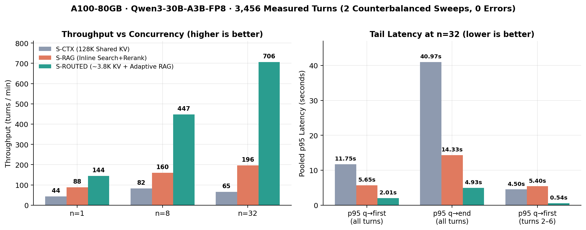
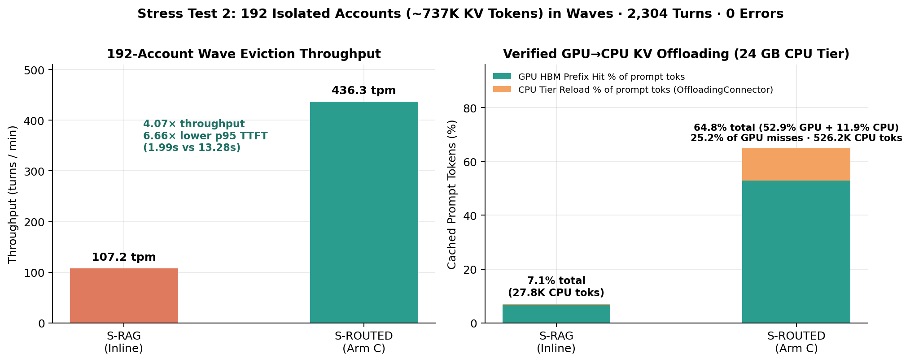
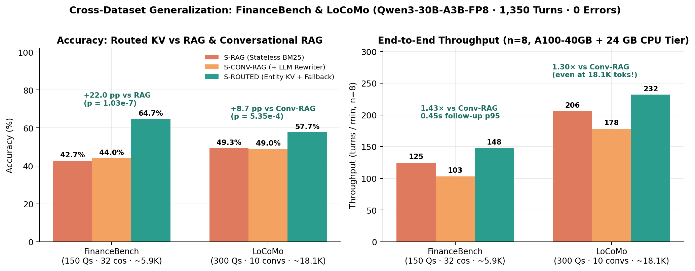

# Entity-Routed Working-Set KV + Adaptive RAG vs Inline RAG vs Shared 128K KV

An apples-to-apples 3-arm systems evaluation on the verified `a100-inline-4608` enterprise CRM lookup corpus (`Qwen/Qwen3-30B-A3B-Instruct-2507-FP8`, single `A100-SXM4-80GB`, `temperature=0`, `seed=0`, `max_tokens=384`, end-to-end timing from question arrival before retrieval/routing).

## Core Finding

Monolithic 128K prefix caching loses to inline RAG on CRM lookups because decode attention still scales with $O(L)$ per token and look-alike accounts act as distractors. **Shrinking and routing the KV unit** — caching each session's ~3.8K-token account dossier in KV and falling back to inline RAG only for cross-account or policy turns — **beats both baselines**:

- **Clean CRM (`n=32`, 3,456 turns):** `S-ROUTED` hits **706.5 turns/min** (**10.8×** over 128K Shared KV, **3.61×** over Inline RAG) and **0.54 s** follow-up p95 (**10×** faster than RAG), with **97.9% accuracy** (**100%** on look-alike Cat B).
- **Noisy / Implicit Queries (`n=32`, 768 turns):** With Turn-1 account typos and Turn 2–6 `"this account"` follow-ups, stateless `S-RAG` collapses to **74.9%** while `S-ROUTED` holds **98.1%** (**+23.2 pp**, exact McNemar `p = 1.44e-20`) at **3.49× throughput**.
- **192-Account Multi-Tenant Eviction (`n=32`, 2,304 turns, 24 GB CPU KV tier):** Forcing `~737K` KV tokens past GPU HBM in waves triggers **526.2K tokens** of CPU→GPU KV reloads; `S-ROUTED` widens its lead to **4.07× throughput** (`436.3` vs `107.2` tpm) and **6.66× lower `q→first` p95** (`1.99 s` vs `13.28 s`).

---

## 1. Clean 3-Arm Head-to-Head (`a100_3arm_v1`)

2 counterbalanced sweeps × 32 sessions × 6 turns × 3 arms × 3 loads = **3,456 measured turns, 0 errors**. Each cell is isolated with a fresh UUID system-prefix salt.



| Load | Arm | Throughput (tpm) | p95 `q→first` | p95 `q→end` | p95 turns 2–6 | Prompt toks | GPU KV hit % | Accuracy (A / B / D) |
|---|---|---:|---:|---:|---:|---:|---:|---:|
| **n=1** | `S-CTX` (128K KV) | 43.7 (42.9, 44.6) | 0.70 s | 1.97 s | 0.70 s | 128,169 | 99.91% | 82.8% (83.6 / 78.1 / 84.4) |
| | `S-RAG` (Inline) | 88.5 (88.3, 88.7) | 0.35 s | 1.10 s | 0.35 s | 5,959 | 72.83% | 99.4% (100 / 98.4 / 98.0) |
| | **`S-ROUTED`** | **144.4** (144.0, 144.7) | **0.20 s** | **0.75 s** | **0.13 s** | **3,841** | **87.35%** | **98.0%** (98.0 / 100 / 95.7) |
| **n=8** | `S-CTX` (128K KV) | 82.5 (83.0, 82.0) | 2.27 s | 8.92 s | 1.96 s | 128,167 | 99.91% | 85.4% (86.7 / 81.3 / 84.0) |
| | `S-RAG` (Inline) | 159.8 (159.6, 160.0) | 1.85 s | 5.15 s | 1.78 s | 5,957 | 72.81% | 99.8% (100 / 100 / 98.8) |
| | **`S-ROUTED`** | **447.1** (444.0, 450.1) | **0.26 s** | **1.91 s** | **0.24 s** | **3,840** | **87.34%** | **97.8%** (97.7 / 100 / 96.1) |
| **n=32** | `S-CTX` (128K KV) | 65.3 (66.1, 64.6) | 11.75 s | 40.97 s | 4.50 s | 128,169 | 99.91% | 84.3% (85.2 / 79.7 / 85.5) |
| | `S-RAG` (Inline) | 195.9 (196.7, 195.1) | 5.65 s | 14.33 s | 5.40 s | 5,960 | 72.86% | 99.5% (100 / 100 / 97.3) |
| | **`S-ROUTED`** | **706.5** (702.8, 710.2) | **2.01 s** | **4.93 s** | **0.54 s** | **3,840** | **87.34%** | **97.9%** (97.7 / 100 / 96.9) |

- Paired exact McNemar at `n=32`: `S-ROUTED` vs `S-CTX` `p = 1.33e-13`; `S-ROUTED` vs `S-RAG` `p = 0.118` (not statistically significant).
- **Miss audit (`b1_n32_S-ROUTED`, 185/192 exact):** **0 routing errors** across all 192 turns. The 3 Cat A misses (`A-069`, `A-024`, `A-114`) are a formatting quirk where the profile literally says `Procurement portal: None` and the model wrote `"listed as None ... Answer: No such record exists."` instead of `"Answer: None"`. The 4 Cat D misses (`D-018`, `D-138`, `D-046`, `D-093`) all scored `0.75` (3/4 rubric items).

---

## 2. Stress Test 1 — Noisy & Implicit Routing (`a100_stress_noisy`)

Deterministically injects Turn-1 single-character typos (`--noisy-routing`, `seed=42`) and replaces explicit account names with `"this account"` on 50% of single-entity Cat A follow-ups (Turns 2–6). Both arms receive identical corrupted questions (**768 turns, 2 sweeps, 0 errors**).


| Arm (`n=32`) | Throughput | p95 `q→first` | p95 `q→end` | p95 turns 2–6 | Accuracy (A / B / D) | Exact McNemar |
|---|---:|---:|---:|---:|---:|---|
| `S-RAG` (Inline) | 181.7 tpm | 6.34 s | 15.88 s | 5.97 s | **74.9%** (64.1 / 96.9 / 96.1) | baseline |
| **`S-ROUTED`** | **634.5 tpm (3.49×)** | **2.02 s** | **5.14 s** | **0.66 s** | **98.1%** (97.7 / 100 / 98.0) | `b_only=100` vs `a_only=9`, **`p = 1.44e-20`** |

- Route breakdown (`b1_n32_S-ROUTED`, 192 turns): `104` exact/fuzzy entity hits, `50` pronoun carry-overs, `32` cross-account dossiers, `6` adaptive RAG fallbacks (`19.8%` total fallback rate).

---

## 3. Stress Test 2 — 192-Account Multi-Tenant KV Eviction (`a100_stress_evict192`)

Expands the 32 sessions across 6 isolated tenant namespaces (`--tenant-scale 6` → **192 distinct account KV prefixes**, `~737K` KV tokens) executed in turn-by-turn waves (`--wave-eviction`) so Turn 1 evicts cold accounts out of GPU HBM (`--gpu-memory-utilization 0.65`) into a **24 GB CPU KV tier** (vLLM native `OffloadingConnector`). **2,304 measured turns, 0 errors**.



| Arm (`n=32`, 192 tenants) | Throughput | p95 `q→first` | p95 `q→end` | p95 turns 2–6 | GPU KV hit % | CPU KV reload % (toks) | Accuracy |
|---|---:|---:|---:|---:|---:|---:|---:|
| `S-RAG` (Inline) | 107.2 tpm | 13.28 s | 35.62 s | 13.84 s | 6.7% | 0.4% (27,776) | 99.5% |
| **`S-ROUTED`** | **436.3 tpm (4.07×)** | **1.99 s (6.7×)** | **10.25 s (3.5×)** | **2.35 s (5.9×)** | **52.9%** | **25.2% (526,208)** | **97.9%** |

---

## Limitations & Disclosures

1. **CPU offload backend:** Stress Test 2 and the SOTA runs used vLLM's built-in `OffloadingConnector` (`cpu_bytes_to_use = 24 GiB`) because the prebuilt `lmcache` wheel on PyPI hit a PyTorch C++ ABI mismatch on Colab Python 3.13 (`lmcache/c_ops.so` undefined symbol). Both offload KV blocks to host RAM over PCIe.
2. **Corpus & model scope:** All 7,878 measured turns ran on `Qwen3-30B-A3B-Instruct-2507-FP8` (3B active MoE) across 3 distinct datasets (CRM ~3.8K, FinanceBench ~5.9K, LoCoMo ~18.1K). Dense models, sliding-window MoEs, 50K+ single-entity dossiers, and open-domain search without entity locality remain outside this release.
3. **Stateless vs conversational RAG:** On CRM, `S-RAG` mirrors the baseline stateless inline retriever. Section 5 explicitly adds **`S-CONV-RAG`** (with an LLM query rewriter) on FinanceBench and LoCoMo; `S-ROUTED` still beat `S-CONV-RAG` on both accuracy (`+20.7 pp` / `+8.7 pp`) and throughput (`1.43×` / `1.30×`).

---

## 5. Cross-Dataset Generalization: FinanceBench & LoCoMo vs Conversational RAG (1,350 turns, 0 errors)

To test whether entity-routed KV generalizes beyond CRM and beats **conversational RAG with an LLM query rewriter** (`S-CONV-RAG`), we evaluated `Qwen3-30B-A3B-Instruct-2507-FP8` on two public SOTA benchmarks (`n=8`, A100-SXM4-40GB + 24 GB vLLM `OffloadingConnector`, `0` errors):



| Benchmark | Arm | Throughput (`n=8`) | p95 `q→first` (follow-ups) | p95 `q→end` | Prompt toks | Token F1 | Accuracy | Exact McNemar vs `S-ROUTED` |
|---|---|---:|---:|---:|---:|---:|---:|---|
| **FinanceBench** *(all 150 Qs · 32 companies)* | `S-RAG` (BM25 top-5) | 124.7 tpm | 0.97 s (0.89 s) | 6.37 s | 5,166 | 47.1% | 42.7% | `a=4, b=37`, **`p = 1.03e-7`** |
| | `S-CONV-RAG` *(+ LLM rewriter, 1.08 s)* | 103.2 tpm | 2.37 s (2.37 s) | 8.96 s | 5,181 | 48.6% | 44.0% | `a=5, b=36`, **`p = 7.84e-7`** |
| | **`S-ROUTED`** *(~5.9K company KV + fallback)* | **147.6 tpm (1.43×)** | **0.82 s (0.45 s)** | **6.54 s** | **5,895** | **71.0%** | **64.7%** | *(124 entity, 9 carry, 17 fallback)* |
| **LoCoMo** *(300 Qs · 10 multi-session convs)* | `S-RAG` (BM25 top-5) | 205.9 tpm | 0.73 s (0.65 s) | 4.49 s | 3,742 | 45.4% | 49.3% | `a=13, b=38`, **`p = 6.21e-4`** |
| | `S-CONV-RAG` *(+ LLM rewriter, 0.59 s)* | 178.0 tpm | 1.62 s (1.62 s) | 4.66 s | 3,746 | 45.3% | 49.0% | `a=14, b=40`, **`p = 5.35e-4`** |
| | **`S-ROUTED`** *(~18.1K conv KV + fallback)* | **231.9 tpm (1.30×)** | **2.29 s (0.76 s)** | **4.68 s** | **18,136** | **51.4%** | **57.7%** | *(252 entity, 33 carry, 15 fallback)* |

- **FinanceBench (`+22.0 pp` vs `S-RAG`, `+20.7 pp` vs `S-CONV-RAG`):** The biggest leap is on `metrics-generated` multi-table calculations (`14.0%` / `16.0%` → **`76.0%`**), where top-5 retrieval drops needed financial lines while pinning the company's ~5.9K dossier preserves full recall at **0.45 s** follow-up p95 (**5.3×** faster than `S-CONV-RAG`).
- **LoCoMo (`+8.3 pp` vs `S-RAG`, `+8.7 pp` vs `S-CONV-RAG`):** Even at **18.1K tokens** per conversation (~4.8× longer prompts than RAG), `S-ROUTED` still beat both RAG baselines on throughput (**1.13×** vs `S-RAG`, **1.30×** vs `S-CONV-RAG`) while jumping **+15.9–18.3 pp** on temporal reasoning (Cat 2: `56.1%` / `53.7%` → **`72.0%`**) and **+8.5–10.9 pp** on multi-hop (Cat 1: `37.8%` / `35.4%` → **`46.3%`**).

---

## Reproducing

Code & tests: [`steer/playbox_steer/kv_routed.py`](../steer/playbox_steer/kv_routed.py), [`steer/playbox_steer/kv_sota_bench.py`](../steer/playbox_steer/kv_sota_bench.py), [`steer/tools/kv_routed_run.py`](../steer/tools/kv_routed_run.py), [`steer/tools/kv_sota_run.py`](../steer/tools/kv_sota_run.py), [`steer/tests/test_kv_routed.py`](../steer/tests/test_kv_routed.py), [`steer/tests/test_kv_sota.py`](../steer/tests/test_kv_sota.py).

```bash
# Local unit + mock-server tests (9/9)
PYTHONPATH=steer pytest --noconftest steer/tests/test_kv_routed.py steer/tests/test_kv_sota.py -q

# Clean 3-arm run
PYTHONPATH=steer python3 steer/tools/kv_routed_run.py \
  --bundle-dir /path/to/a100-inline-4608 \
  --out-dir results/a100_3arm_v1 \
  --arms S-RAG,S-CTX,S-ROUTED --loads 1,8,32 --sweeps 2 --max-sessions 32

# Stress Test 1: Noisy / implicit routing
PYTHONPATH=steer python3 steer/tools/kv_routed_run.py \
  --bundle-dir /path/to/a100-inline-4608 \
  --out-dir results/a100_stress_noisy \
  --arms S-RAG,S-ROUTED --loads 32 --sweeps 2 --max-sessions 32 --noisy-routing

# Stress Test 2: 192-account wave eviction (run vLLM with OffloadingConnector 24GB CPU tier)
PYTHONPATH=steer python3 steer/tools/kv_routed_run.py \
  --bundle-dir /path/to/a100-inline-4608 \
  --out-dir results/a100_stress_evict192 \
  --arms S-RAG,S-ROUTED --loads 32 --sweeps 1 --max-sessions 32 \
  --tenant-scale 6 --wave-eviction
```
