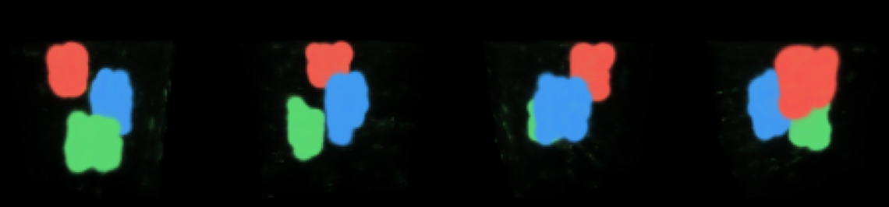

# world

Learn a 3D scene from agent events. A from-scratch PyTorch version of instant-ngp's core (multiresolution hash encoding, tiny MLP, volume rendering), supervised by events instead of photographs. It does not use NVlabs code: instant-ngp is CUDA-only and non-commercial licensed.



## How it works
1. **Events** (`{"t","agent","kind","text"}` JSONL; message, action, reasoning, commit) get a text embedding.
2. **Layout** (`layout.py`): a small network places each event in the unit cube. z follows time; x,y are trained so similar events cluster and dissimilar ones separate.
3. **Field** (`scene.py`): a hash-grid + MLP is fit to the placed events: density from event mass (commits weigh most, reasoning least), colour from topic cluster.
4. **Render**: emission-absorption volume rendering from an orbit camera.

## Run
```sh
python3 -m venv .venv && .venv/bin/pip install torch numpy matplotlib pytest
.venv/bin/python -m playbox_world.demo [events.jsonl] [out.png]   # synthetic events by default
.venv/bin/python -m pytest -q
```

## Limits
- There is no photometric ground truth. The scene is whatever the layout objective makes it, so quality depends on the embedding and the loss, not on matching reality.
- The embedding is a hashed bag of words, a stand-in for a real sentence embedder.
- Training is not deterministic across hardware, so the scene is a view of the history, not proof of it. The signed log stays the source of truth.
- Only synthetic data so far; untested on real session logs.
